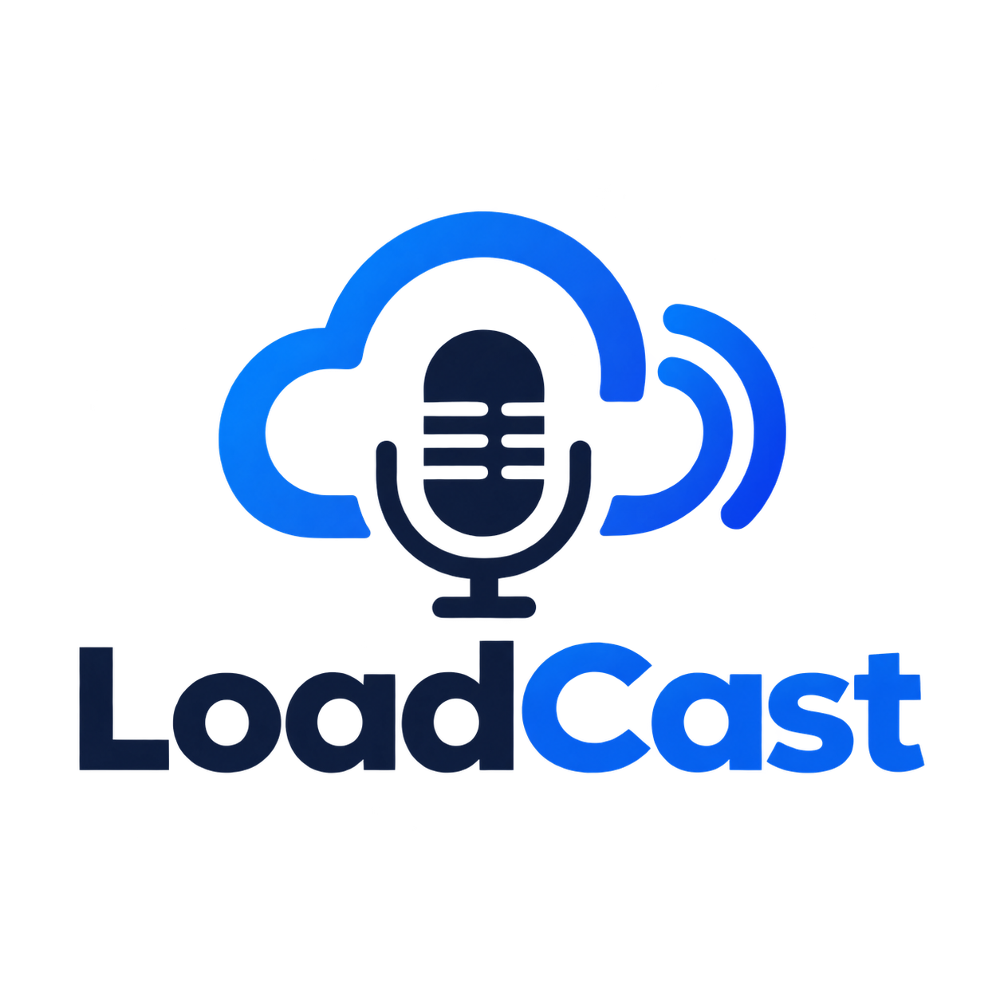
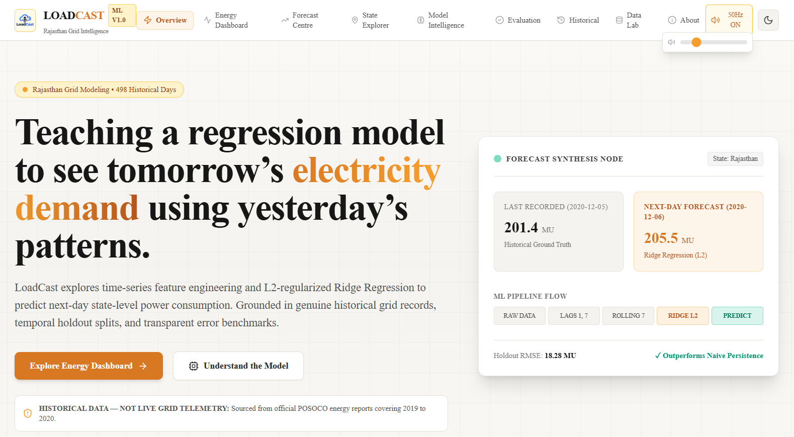
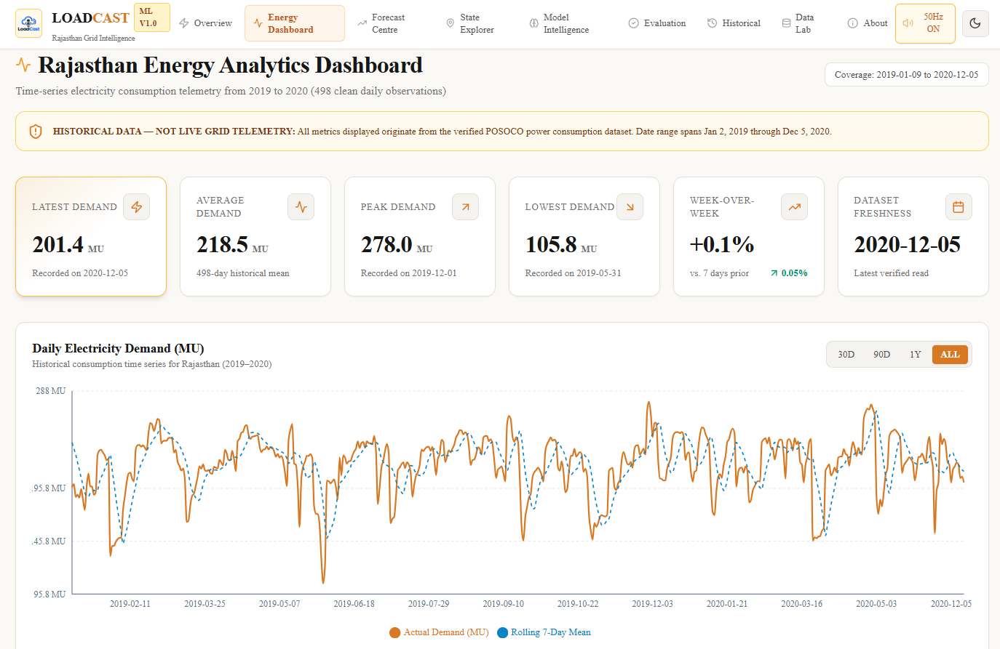
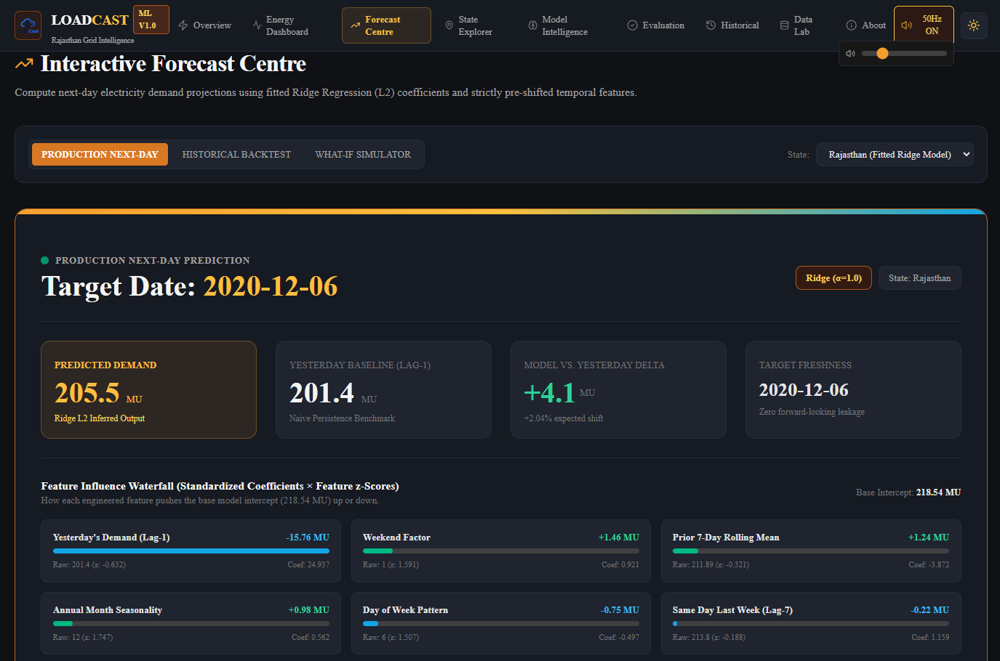
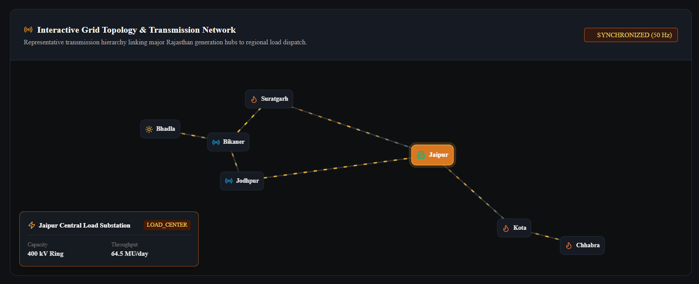
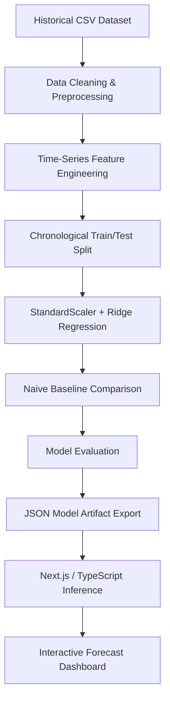

<div align="center">



# LOADCAST ⚡

### Teaching a regression model to see tomorrow's electricity demand using yesterday's patterns.

An interactive electricity demand forecasting platform powered by time-series feature engineering and Ridge Regression — built on genuine POSOCO grid data for the state of Rajasthan, India.

[](https://nextjs.org/)
[](https://react.dev/)
[](https://www.typescriptlang.org/)
[](https://python.org/)
[](https://pandas.pydata.org/)
[](https://numpy.org/)
[](https://scikit-learn.org/)
[](https://tailwindcss.com/)
[](https://recharts.org/)
[](https://loadcast.vercel.app/)

**[🌐 Live Demo](https://loadcast.vercel.app/) &nbsp;·&nbsp; [📦 GitHub Repository](https://github.com/dk-khandelwal06/loadcast) &nbsp;·&nbsp; [💼 LinkedIn](https://www.linkedin.com/in/daksh-khandelwal-b02748391/) &nbsp;·&nbsp; [🎥 Demo Video]()**

</div>

<br/>

<div align="center">
  
  <p><i>LoadCast — Electricity Demand Intelligence Platform</i></p>
</div>

<br/>

## 📖 01 — Introduction

**LoadCast** is a full-stack electricity demand forecasting platform that turns a historical Indian power-grid dataset into an interactive, explainable forecasting tool. It predicts **next-day electricity demand** for the state of **Rajasthan** by learning temporal patterns — yesterday's load, last week's load, and seasonal rhythm — from genuine data published by **POSOCO** (Power System Operation Corporation of India).

Demand forecasting matters because grid operators have to commit generation capacity *before* the demand actually arrives: under-forecasting risks blackouts, over-forecasting wastes fuel and money. LoadCast focuses on Rajasthan as a single, well-understood starting point — a large, climatically diverse state with clean POSOCO coverage in the underlying dataset — rather than spreading a small dataset thin across all 33 regions.

Under the hood, the project connects two worlds: **Python** handles the offline statistical learning (cleaning, feature engineering, Ridge Regression, evaluation), and a **Next.js/TypeScript** application reproduces the fitted model's math natively in the browser for instant, serverless inference — no Python runtime required in production.

## 🧩 02 — The Problem

Electricity demand is a moving target that grid operators must estimate *ahead of time*:

- Consumption changes continuously — by hour, by day of week, by season.
- Generation has to be scheduled in advance; it cannot react instantly to actual load.
- **Over-forecasting** wastes generation capacity and money.
- **Under-forecasting** risks supply shortfalls and instability.
- Historical consumption data holds real, exploitable temporal structure — yesterday's load is a strong signal for tomorrow's.
- A common pitfall in applied ML: **randomly shuffling time-series data** before a train/test split silently leaks future information into training, producing misleadingly good offline scores that don't hold up in production.

LoadCast is built specifically to respect that last point — every evaluation here is **strictly chronological**.

## 💡 03 — Our Solution

LoadCast addresses the forecasting problem with a deliberately interpretable pipeline rather than a black-box deep model:

- **Historical electricity consumption** — 498 cleaned daily observations sourced from real POSOCO reports.
- **Time-series feature engineering** — lag and rolling-window features that encode temporal memory without leaking the future.
- **Chronological model evaluation** — an 80/20 holdout split that preserves time order, never shuffled.
- **Ridge Regression (L2-regularized)** — handles the strong collinearity between lagged features while staying fully interpretable.
- **Naive persistence baseline** — "tomorrow = today" — the bar the model must actually beat to be worth using.
- **Interactive forecast visualizations** — dashboards, charts, and a live next-day forecast centre.
- **Model explainability** — the fitted coefficients, intercept, and scaler parameters are surfaced directly in the UI.

The core design decision: an **interpretable linear model**, not an oversized neural network, because the dataset is small (under 500 daily points) and a transparent model that clearly beats a naive baseline is more trustworthy — and easier to deploy at zero cost — than a complex one that merely looks impressive.

## ✨ 04 — Key Features

| Feature | Description |
|---|---|
| 📊 **Interactive Energy Dashboard** | KPI cards, daily/weekly load curves, monthly seasonality, and day-of-week breakdowns |
| 🔮 **Next-Day Forecast Centre** | Live Ridge Regression inference running natively in the browser |
| ⚡ **Interactive Grid Topology** | Animated power-grid visualization built with HTML5 Canvas |
| 🗺️ **State Explorer** | Interactive SVG map of India covering all 33 states/UTs in the dataset, spotlighting Rajasthan |
| 🧠 **Model Intelligence** | Transparent view into fitted coefficients, intercept, alpha, and scaler parameters |
| 📈 **Forecast Evaluation** | Ridge vs. naive-baseline scorecard, residual distribution, and COVID-19 structural-break analysis |
| 🕰️ **Historical Analytics** | Searchable, paginated time-series browser |
| 🧪 **Data Laboratory** | Data-quality audit — duplicate resolution, continuity gaps, and schema checks |
| 🌗 **Light & Dark Mode** | Full theme toggle across the entire application |
| 🔊 **Grid Ambience Audio** | Optional, synthesized 50 Hz "grid hum" ambience with an in-app volume control |

## 🖼️ 05 — Application Preview

<div align="center">
  <h3>⚡ Energy Dashboard</h3>
  
  <p><i>Interactive electricity demand analytics and historical consumption visualization.</i></p>
</div>

<br/>

<div align="center">
  <h3>🔮 Forecast Centre</h3>
  
  <p><i>Next-day demand prediction powered by in-browser Ridge Regression inference.</i></p>
</div>

<br/>

<div align="center">
  <h3>🗺️ Interactive Grid</h3>
  
  <p><i>Animated power-grid topology and state-level exploration.</i></p>
</div>

## ⚙️ 06 — How LoadCast Works



Python owns the **offline training loop** — cleaning, feature engineering, fitting, and evaluation. The fitted Ridge coefficients and `StandardScaler` parameters are then exported as versioned JSON artifacts. The deployed **Next.js** application re-implements the same linear formula natively in **TypeScript**, so every prediction served in production runs with zero Python runtime, zero cold starts, and zero added inference cost — verified to match the Python output within floating-point tolerance (`src/ml/verify_inference.py`).

## 🔬 07 — Machine Learning Methodology

**Dataset**
- *Power Consumption in India (2019–2020)* — state-wise daily electricity consumption, POSOCO-sourced, distributed via Kaggle (`twinkle0705`).
- **498 clean daily observations**, spanning **2 January 2019 → 5 December 2020**.
- Target state: **Rajasthan**. Units: **MU (Mega Units / Million kWh)**.
- 5 duplicate-dated entries resolved via daily arithmetic mean; 22 reporting-gap periods identified and documented (see [`docs/data_dictionary.md`](docs/data_dictionary.md)).

**Engineered Features**

| Feature | Definition | Why It Helps |
|---|---|---|
| `lag_1` | Yesterday's demand | Immediate load persistence |
| `lag_7` | Demand 7 days ago | Weekly periodicity (same weekday last week) |
| `rolling_mean_7` | 7-day rolling average | Smoothed trend / mean-reversion signal |
| `day_of_week` | 0–6 | Industrial & commercial weekly schedules |
| `month` | 1–12 | Seasonal (summer cooling, monsoon, agricultural pumping) |
| `is_weekend` | 0/1 | Saturday/Sunday operational shift |

All lag and rolling features are computed strictly from `demand.shift(1)`, so the target for day *t* never leaks into its own predictors.

**Model**
- **Ridge Regression** with **L2 regularization** (`alpha = 1.0`) — chosen because lagged features are highly collinear (`corr(lag_1, lag_7) ≈ 0.85`), which destabilizes ordinary least squares.
- **StandardScaler**, fit strictly on the training split only, then applied to the test split — preventing any statistical leakage from test data into training.

**Temporal Evaluation**
- **Chronological 80/20 holdout** — training on the earliest 80% of observations, testing on the most recent 20%. No random shuffling, ever.
- This matters because shuffling a time series before splitting lets the model "see the future" during training, producing deceptively optimistic metrics that collapse in real deployment.

## 📊 08 — Model Performance

Evaluated on a **99-day chronological holdout** (29 Feb 2020 → 5 Dec 2020), against a naive "tomorrow = today" persistence baseline:

| Metric | Ridge Regression | Naive Baseline | Improvement |
|---|---:|---:|---:|
| **RMSE** | 18.28 MU | 19.36 MU | **+5.6%** |
| **MAE** | 11.25 MU | 11.32 MU | +0.55% |
| **MAPE** | 5.52% | 5.56% | +0.68% |

The model consistently beats the naive baseline across all three metrics, though the margin is modest — reflecting how strongly next-day demand is already anchored by the previous day's value. The holdout period includes the March–May 2020 COVID-19 lockdown structural break; LoadCast's evaluation surfaces this explicitly rather than hiding it (see the **Forecast Evaluation** page), including a lockdown-vs-non-lockdown metric breakdown computed separately in `artifacts/evaluation_metrics.json`.

> LoadCast does not claim production-grade forecasting accuracy. It is evaluated transparently against a simple, honest baseline — and the honest result is a real, if modest, improvement.

## 🛠️ 09 — Technology Stack

**Frontend**

| Next.js | React | TypeScript | Tailwind CSS | Framer Motion | Recharts | Lucide React |
|---|---|---|---|---|---|---|

**Machine Learning**

| Python | Pandas | NumPy | scikit-learn | StandardScaler | Ridge Regression |
|---|---|---|---|---|---|

**Deployment**

| GitHub | Vercel |
|---|---|

## 🏗️ 10 — Architecture

LoadCast deliberately separates **offline scientific training** from **online inference**:

- **Offline (Python):** `src/ml/` handles data cleaning (`data_prep.py`), feature engineering (`features.py`), model fitting and evaluation (`model.py`, `evaluate.py`), and exports versioned JSON model artifacts (`export_artifacts.py`).
- **Artifact bridge:** The fitted Ridge coefficients, intercept, and `StandardScaler` parameters are serialized into `artifacts/model_artifact.json` and `artifacts/evaluation_metrics.json`.
- **Online (TypeScript):** `src/lib/ml-engine.ts` re-implements the exact Ridge inference formula in pure TypeScript, so predictions run natively inside Next.js API routes (`src/app/api/forecast/next-day`) with no Python runtime in production.
- **Security:** in-memory rate limiting (`src/lib/rate-limiter.ts`) and hardened response headers (`X-Frame-Options`, `X-Content-Type-Options`, `Referrer-Policy`) are applied to public API routes; no secrets are ever exposed to client code.

Full technical detail, including the architectural trade-off analysis, lives in [`docs/architecture.md`](docs/architecture.md).

## 📁 11 — Project Structure

```text
loadcast/
├── assets/              # README screenshots & logo
├── artifacts/           # Exported JSON model artifacts (coefficients, metrics, data)
├── data/
│   ├── raw/              # Original Kaggle CSVs
│   └── processed/        # Cleaned, feature-ready daily series
├── notebooks/            # EDA & feature engineering notebooks
├── src/
│   ├── ml/                # Python training pipeline (prep → features → model → export)
│   ├── lib/                # TypeScript inference engine, data service, contexts
│   ├── components/      # UI components, charts, grid canvas, India map
│   └── app/               # Next.js App Router pages & API routes
├── docs/                 # Architecture, methodology, data dictionary, learnings
└── tests/                # Python + Node inference/consistency tests
```

## 🚀 12 — Installation and Local Setup

**Prerequisites:** Node.js, Python, npm, pip

```bash
git clone https://github.com/dk-khandelwal06/loadcast.git
cd loadcast

npm install
pip install -r requirements.txt
```

**Train and verify the model:**

```bash
npm run ml:train     # Runs the Python pipeline and exports JSON artifacts
npm run ml:verify     # Verifies Python/TypeScript inference equivalence
npm run test:ml        # Runs automated Python pipeline unit tests
```

**Start the development server:**

```bash
npm run dev
```

Then open **[http://localhost:3000](http://localhost:3000)**.

## 🔐 13 — Environment Variables

LoadCast's core forecasting functionality requires **no external API credentials** — inference runs entirely on exported model parameters.

| Variable | Required | Purpose |
|---|---|---|
| `NODE_ENV` | No (defaults to `development`) | Runtime environment |
| `NEXT_PUBLIC_APP_URL` | No (defaults to `http://localhost:3000`) | Public app base URL |
| `RATE_LIMIT_PER_MINUTE` | No (defaults to `60`) | Public API rate-limit threshold |
| `GEMINI_API_KEY` | No — optional | Reserved for optional, future natural-language explanations; not required for core forecasting |

See [`.env.example`](.env.example) for the full template.

## ☁️ 14 — Deployment

LoadCast is deployed on **[Vercel](https://loadcast.vercel.app/)**, which suits the project well because the production inference path is pure TypeScript — there's no Python server to host or keep warm.

1. Push the repository to GitHub.
2. Import the repository on [Vercel](https://vercel.com) → **Add New Project**.
3. Framework preset: **Next.js** (auto-detected) · Build command: `npm run build`.
4. Add any optional environment variables from the table above.
5. Deploy.

## 🔭 15 — Limitations and Future Scope

**Current Limitations**
- Built on a **historical dataset** (through December 2020), not a live telemetry feed.
- Only ~17–23 months of daily history — seasonal patterns are limited.
- Only **Rajasthan** has a trained forecasting model; other states are shown for historical/exploratory visualization only, not forecasting.
- No weather covariates (temperature, humidity) in the current model.
- The dataset spans the March–May 2020 COVID-19 lockdown, a genuine structural break in demand that the evaluation reports on but does not fully compensate for.

**Future Development**
- Weather-integrated forecasting (temperature, humidity as additional features).
- SARIMA / Prophet model comparisons.
- Multi-state trained forecasting models, beyond Rajasthan.
- Expanded, more recent historical data coverage.

## ⚠️ 16 — Disclaimer

> LoadCast is an educational and scientific electricity-demand forecasting project based on historical data. Its experimental predictions must not be used for operational grid control, safety-critical switching, or electricity dispatch decisions.

---

<div align="center">

## 👤 Author

**Daksh Khandelwal**

AI & Data Science Undergraduate · IIT Jodhpur

[LinkedIn](https://www.linkedin.com/in/daksh-khandelwal-b02748391/) &nbsp;·&nbsp; [GitHub](https://github.com/dk-khandelwal06) &nbsp;·&nbsp; [Live Project](https://loadcast.vercel.app/)

<sub>Built as part of Project Atlas — a long-term applied AI learning journey.</sub>

</div>
